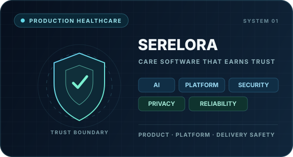
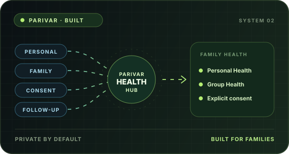
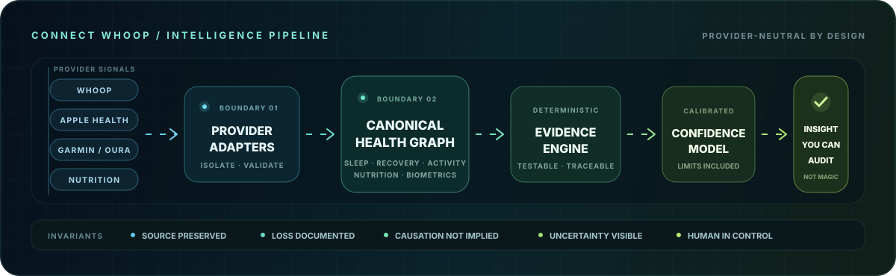
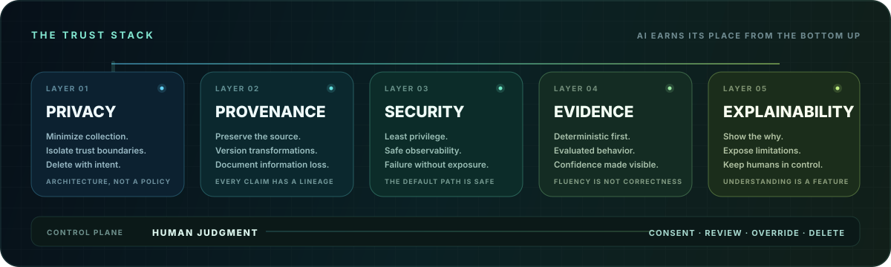

<picture>
  <source media="(prefers-color-scheme: dark)" srcset="./assets/hero-dark.svg">
  <source media="(prefers-color-scheme: light)" srcset="./assets/hero-light.svg">
  
</picture>

  <strong>AI ENGINEERING</strong>&nbsp;&nbsp;·&nbsp;&nbsp;
  <strong>HEALTH INTELLIGENCE</strong>&nbsp;&nbsp;·&nbsp;&nbsp;
  <strong>SECURE PLATFORMS</strong>

  <a href="#selected-systems">Selected systems</a> ·
  <a href="#the-intelligence-pipeline">Intelligence pipeline</a> ·
  <a href="#the-trust-stack">Trust stack</a> ·
  <a href="#current-focus">Current focus</a>

## The thesis

> **AI gets interesting when the consequences are real.**

I build at the intersection of intelligent products, sensitive data, and production platforms. My work is shaped by one question: **how do we make AI useful without making the system less trustworthy?**

That means intelligence with provenance. Recommendations with confidence. Privacy enforced by architecture. Delivery systems that make the safe path the fast path.

## Selected systems

<table>
  <tr>
    <td width="50%" valign="top">
      
      <h3>Serelora</h3>
      
<strong>Production healthcare platform</strong>

      
I contribute across AI product engineering, platform architecture, security guardrails, delivery safety, and privacy-sensitive patient and practice workflows.

      
<code>AI systems</code> <code>Platform</code> <code>Security</code> <code>Privacy</code> <code>Reliability</code>

      
<a href="https://serelora.com">Visit Serelora →</a>

    </td>
    <td width="50%" valign="top">
      
      <h3>Parivar</h3>
      
<strong>Global family health hub</strong>

      
I built Parivar to bring personal health and family care into one place. Personal Health keeps individual information private; Group Health helps families understand and follow up together through explicit permissions.

      
<code>SwiftUI</code> <code>Swift / Vapor</code> <code>PostgreSQL</code> <code>Consent</code>

      
<strong>Built for families everywhere</strong>

    </td>
  </tr>
</table>

## The intelligence pipeline

  

This is the architecture behind the product philosophy: provider-specific behavior stops at the adapter boundary; analytics operate on canonical concepts; every transformation preserves provenance; and the explanation layer never outruns the evidence.

<table>
  <tr>
    <td width="33%" valign="top">
      <strong>01 · Normalize reality</strong>  
      Translate fragmented provider data into stable health concepts without erasing its origin.
    </td>
    <td width="33%" valign="top">
      <strong>02 · Compute evidence</strong>  
      Prefer deterministic, testable analysis before generative interpretation.
    </td>
    <td width="33%" valign="top">
      <strong>03 · Explain honestly</strong>  
      Surface confidence, limitations, and source observations—not manufactured certainty.
    </td>
  </tr>
</table>

## The trust stack

  

My default is not “add AI.” It is to earn the right to add AI by first establishing the boundaries, evidence, failure modes, and human controls the product requires.

## Current focus

| Signal | Status |
|:--|:--|
| **Parivar** | `BUILT` · Global family health hub |
| **Product experience** | Personal Health + Group Health |
| **Family care** | Private by default, shared by explicit permission |
| **Engineering emphasis** | Privacy, consent, explainability, delivery confidence |

  
<strong>System posture</strong>

   

  - Health and biometric data are treated as highly sensitive.
  - Adults own their health data; family administration does not grant access.
  - Shared family views require explicit permission.
  - Provider integrations remain isolated behind explicit adapter boundaries.
  - Analytics and recommendations consume normalized canonical models.
  - Observations, correlations, hypotheses, and recommendations remain distinct.
  - Generative explanations are downstream of deterministic evidence.
  - Private repositories, credentials, and sensitive implementation details stay private.

 

  <strong>EVIDENCE &gt; ELOQUENCE</strong>&nbsp;&nbsp;·&nbsp;&nbsp;
  <strong>BOUNDARIES &gt; SHORTCUTS</strong>&nbsp;&nbsp;·&nbsp;&nbsp;
  <strong>SYSTEMS &gt; DEMOS</strong>

  <em>Building AI systems people can understand, verify, and trust.</em>

