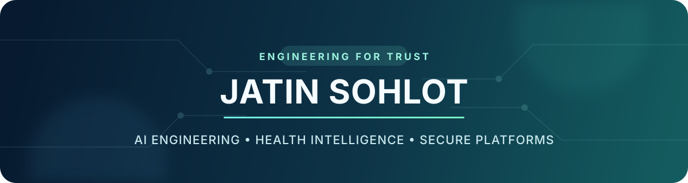

  

  <strong>AI &amp; Platform Engineer building privacy-first health intelligence.</strong>

  <a href="https://serelora.com">Serelora</a>
  &nbsp;•&nbsp; AI Engineering
  &nbsp;•&nbsp; Health Data Platforms
  &nbsp;•&nbsp; Security &amp; Privacy

## About me

I build products where useful AI must coexist with strong engineering boundaries: sensitive data, explainable outcomes, reliable delivery, and systems that remain understandable as they grow.

My work spans product engineering, platform architecture, data systems, security, and privacy—with a particular focus on healthcare and personal health intelligence.

## Selected work

### 🏥 Serelora

A production healthcare platform built around trustworthy, privacy-aware patient and practice experiences.

I contribute across AI product engineering, platform architecture, delivery safety, security guardrails, and privacy-sensitive workflows. The work is private by design, but the engineering goal is simple: ship valuable healthcare software without weakening the trust boundary around it.

`Healthcare` · `AI systems` · `Platform engineering` · `Security` · `Privacy` · `Reliability`

### 🧭 Connect Whoop v3

A mature personal health intelligence product that brings recovery, sleep, activity, workouts, nutrition, and biometrics into a provider-neutral experience.

Its architecture centers on canonical health models, isolated provider adapters, provenance-preserving transformations, and explainable, confidence-aware insights. Recommendations remain traceable to source observations and distinguish association from causation.

The repository remains private. A public-facing application is being prepared for release.

`Health intelligence` · `Data normalization` · `Provider adapters` · `Explainable insights` · `Privacy by design`

## How I approach AI engineering

- **Evidence before output** — evaluated behavior, explicit uncertainty, and traceable inputs.
- **Deterministic foundations first** — structured logic before generative explanation.
- **Privacy as architecture** — minimization, isolation, least privilege, retention, and safe observability.
- **Provider-neutral systems** — integrations translate into canonical models rather than leaking into core logic.
- **Pragmatic delivery** — small production-quality changes, strong validation, and clear rollback paths.

## Current focus

- Preparing the public Connect Whoop experience
- Building explainable personal health insights across multiple data providers
- Applying agent-assisted engineering to ship faster without relaxing review, security, or quality gates
- Designing durable data and platform boundaries for sensitive products

---

  <em>Building AI systems people can understand, verify, and trust.</em>

