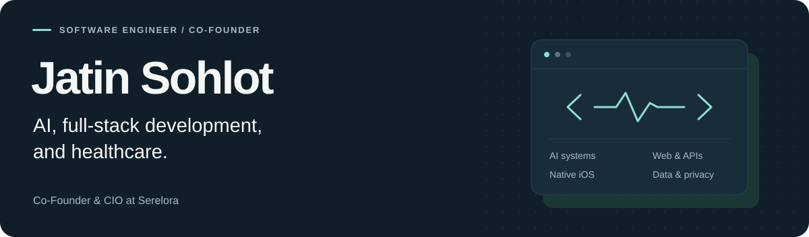
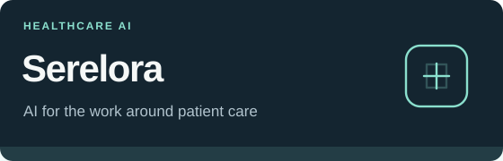
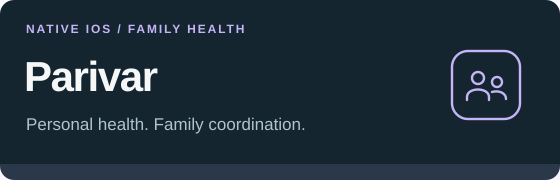

<picture>
  <source media="(max-width: 600px) and (prefers-color-scheme: dark)" srcset="./assets/profile-header-mobile-dark.svg">
  <source media="(max-width: 600px) and (prefers-color-scheme: light)" srcset="./assets/profile-header-mobile-light.svg">
  <source media="(prefers-color-scheme: dark)" srcset="./assets/profile-header-dark.svg">
  <source media="(prefers-color-scheme: light)" srcset="./assets/profile-header-light.svg">
  
</picture>

  <a href="https://serelora.com/about"><strong>Co-Founder &amp; CIO, Serelora</strong></a> &nbsp; / &nbsp;
  <a href="https://www.linkedin.com/in/jatinsohlot/">LinkedIn</a> &nbsp; / &nbsp;
  <a href="#what-i-work-with">Technical skills</a>

I'm Jatin. I build software for healthcare, working across AI, web applications, backend services, and native iOS. At Serelora, I help turn complicated clinical and administrative workflows into software people can use in their daily work.

I work on the interfaces, APIs, data access, and failure handling around those AI features. I also build Parivar, a family health app that keeps each adult in control of their own information.

## The work

<table>
  <tr>
    <td width="50%" valign="top">
      
      <h3>Serelora</h3>
      
<strong>Co-Founder &amp; CIO</strong>

      
AI software for practice operations, including intake, clinical documentation, and administrative work. I contribute across product development, platform architecture, security, and delivery.

      
My engineering work includes application and API development, document workflows, access controls, and the infrastructure behind patient and practice experiences.

      
<code>Healthcare AI</code> <code>Full-stack</code> <code>Platform engineering</code>

      
<a href="https://serelora.com">Product</a> &nbsp; / &nbsp; <a href="https://serelora.com/about">Team</a>

    </td>
    <td width="50%" valign="top">
      
      <h3>Parivar</h3>
      
<strong>Personal and family health app</strong>

      
An iPhone-first app I built around personal health information, selective sharing, and family follow-up. Family organisation and access to someone's health information are separate permissions.

      
The work includes a SwiftUI app, shared domain models, a Vapor API foundation, PostgreSQL authorization, and consent and privacy lifecycle features.

      
<code>SwiftUI</code> <code>Vapor</code> <code>PostgreSQL</code>

      
<strong>V1 candidate, tested with fictional data.</strong> Live integrations and rollout remain gated.

    </td>
  </tr>
</table>

## What I work with

| Area | Technologies and engineering work |
| :--- | :--- |
| **AI applications** | LLM APIs, tool calling, model integrations, structured responses, and validation around AI outputs. |
| **Web and services** | TypeScript, React, Next.js, Node.js, APIs, streaming interfaces, and document workflows. |
| **Native apps** | Swift, SwiftUI, Vapor, shared domain models, and OpenAPI contracts. |
| **Data and access** | PostgreSQL, Prisma, authentication, scoped permissions, row-level authorization, and audit trails. |
| **Infrastructure** | AWS, containers, infrastructure changes, and CI/CD. |
| **Testing** | Vitest, Testing Library, API and authorization checks, and testing failure and retry paths. |

## Some of the problems I care about

**Giving AI the right amount of access.** Tool permissions, validated inputs, and clear review points matter as much as the model. I work on the application code that connects those pieces.

**Keeping health information understandable.** A value needs its source, units, and context. In Parivar, health summaries account for freshness and sharing permissions, and explain why information is visible.

**Building beyond the happy path.** Expired sessions, denied access, failed requests, and changed permissions are part of the product. I spend time on those cases, along with the testing and delivery work behind them.

---

I'm interested in healthcare AI, full-stack engineering, and native health products.

<a href="https://www.linkedin.com/in/jatinsohlot/"><strong>Let's connect on LinkedIn</strong></a> &nbsp; / &nbsp; <a href="https://serelora.com">Serelora</a>
